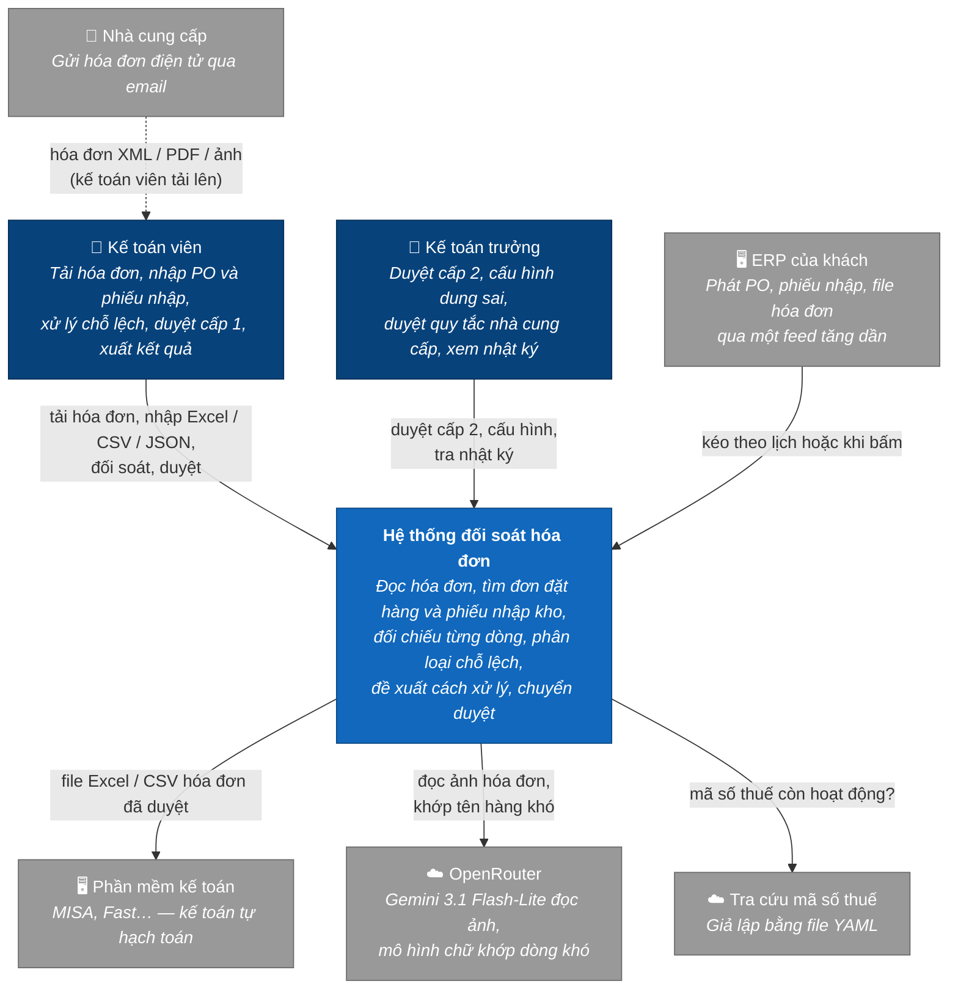
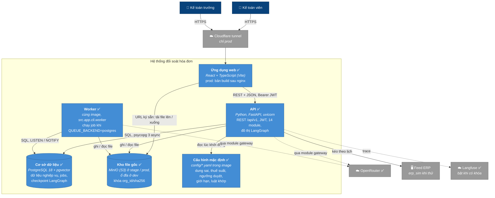
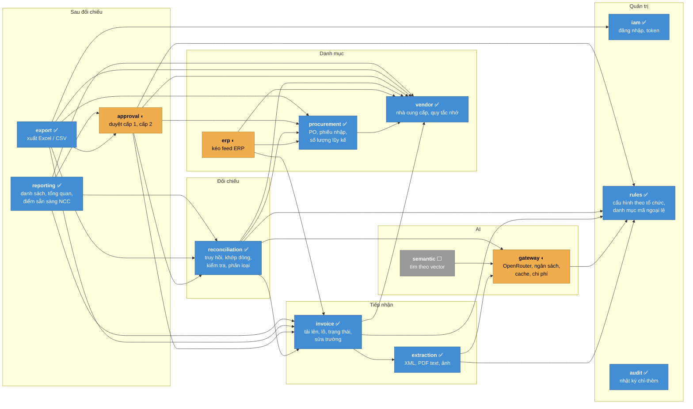
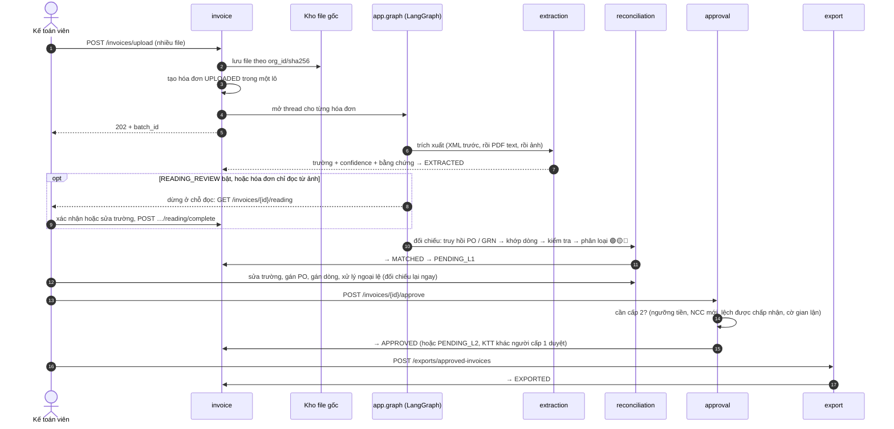
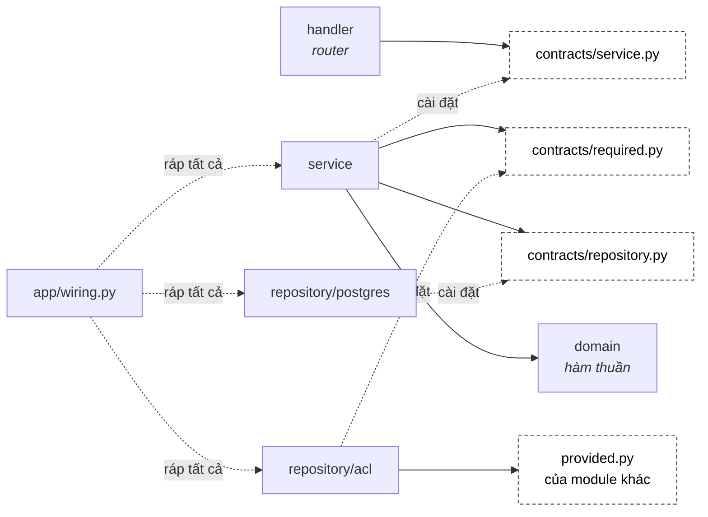
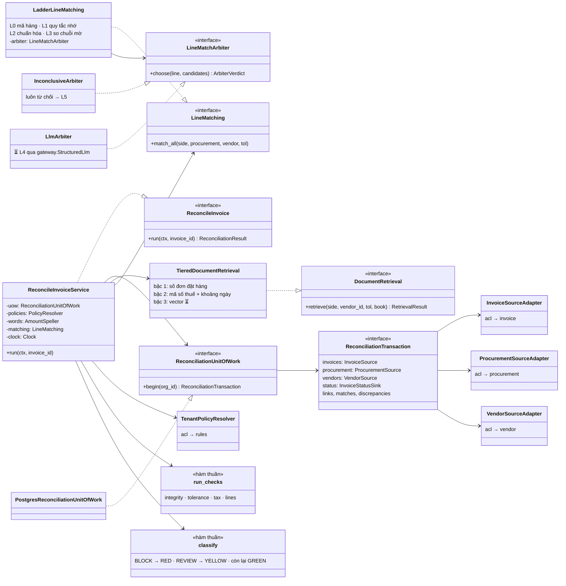
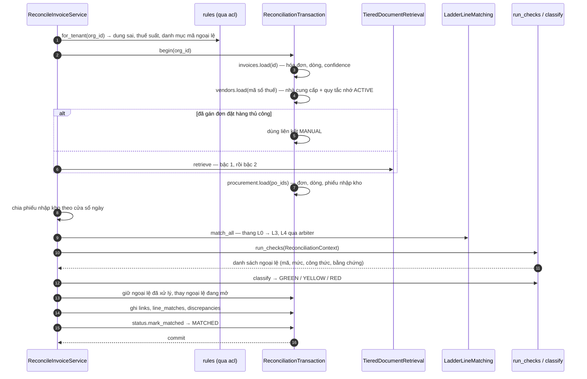

# Thiết kế C4 — Invoice Reconciliation Agent

> Kiến trúc hệ thống theo mô hình C4, từ tổng quan tới code · Ngày 23/09/2026, cập nhật Mức 1–3 ngày 13/10/2026
> Vẽ theo code thật ở repo `P-143`: Mức 1–3 theo `main` tại `0ecb981` (10/10/2026); Mức 4 vẫn theo nhánh `feat/module-api` (23/09)
> Tài liệu liên quan: `PRD.md` (yêu cầu) · `USER_STORIES.md` (tình huống nghiệp vụ) · `P-143/src/module/README.md` (quy tắc module)

**Bản tương tác:** cùng mô hình viết bằng Structurizr DSL ở `docs/c4/workspace.dsl`, có thêm góc nhìn triển khai prod. Xem: `cd docs/c4 && docker compose up -d` rồi mở `http://localhost:8080`.

**C4 là gì.** Bốn mức phóng to dần, mỗi mức trả lời một câu hỏi:

| Mức | Tên | Câu hỏi |
|---|---|---|
| 1 | System Context — bối cảnh | Hệ thống phục vụ ai, nói chuyện với hệ thống nào bên ngoài? |
| 2 | Container — khối triển khai | Hệ thống gồm những khối chạy riêng nào: ứng dụng, cơ sở dữ liệu, kho file? |
| 3 | Component — thành phần | Bên trong khối API chia thành những module nào, module nào phụ thuộc module nào? |
| 4 | Code | Một module được viết thế nào: interface, class, luồng gọi? |

**Ký hiệu trạng thái** dùng trong toàn tài liệu:

| Ký hiệu | Nghĩa |
|---|---|
| ✅ | Đã chạy được, có test |
| 🚧 | Đã có interface hoặc khung, chưa có phần chạy thật |
| ⏳ | Chưa làm |

---

## Mức 1 — Bối cảnh hệ thống



**Ranh giới cần nhớ**

- Hệ thống **không nhận email trực tiếp** từ nhà cung cấp. Hóa đơn vào qua kế toán viên tải lên, hoặc qua feed ERP.
- Hệ thống **không sinh bút toán và không ghi sổ** (PRD F10.1). Nó dừng ở hóa đơn đã duyệt và file xuất; hóa đơn đã xuất chuyển `EXPORTED`.
- Hệ thống **không thanh toán**.
- Dịch vụ AI chỉ được gọi ở các chỗ: đọc hóa đơn không phải XML, khớp tên hàng khó (bậc L4), và xem lại truy hồi PO khi bật `RETRIEVAL_LLM`. **Không có con số nào do AI quyết**: mọi cặp khớp do mô hình đề xuất đều cần người xác nhận.
- Đi ra ngoài chỉ qua một cổng (`gateway`), một khóa `OPENROUTER_API_KEY`. Không có khóa thì PDF / ảnh chuyển sang nhập tay.

---

## Mức 2 — Các khối triển khai



| Khối | Công nghệ | Trạng thái | Ghi chú |
|---|---|:-:|---|
| Ứng dụng web | React + TypeScript (Vite) | ✅ | Ở `frontend/`. Prod phục vụ bản build qua nginx |
| API | FastAPI, uvicorn, psycopg 3 async, SQL thuần, không ORM | ✅ | 65 endpoint (PRD §8), Swagger tại `/docs`, `GET /health` |
| Điều phối | LangGraph 1.2, checkpoint trong PostgreSQL | ✅ | Bộ điều phối duy nhất từ 07/10/2026 (bỏ `inprocess`). Mỗi hóa đơn một thread; dừng bằng `interrupt` ở chỗ chờ người (đọc, sửa, chờ phiếu nhập); sweeper đánh thức thread đang chờ |
| Worker | cùng image | ✅ | Chỉ chạy khi `QUEUE_BACKEND=postgres`. Mặc định của server hiện là `inline`: đồ thị chạy trong tiến trình API |
| Cơ sở dữ liệu | PostgreSQL 18 (`uuidv7()`), pgvector | ✅ | Migration SQL thuần `migrations/0001…0016`, mỗi file có checksum |
| Kho file gốc | `STORAGE_BACKEND=s3` (MinIO) ở stage / prod, `local` ở dev | ✅ | Trùng `sha256` trong cùng tổ chức thì không lưu lại |
| Cấu hình mặc định | YAML | ✅ | KTT sửa qua API thì lưu bản mới ở `config_versions`, đè lên YAML. File YAML hỏng thì API không khởi động |

**Theo dõi:** mỗi lượt pipeline chạy qua một hóa đơn là một trace Langfuse, mỗi bước (trích xuất, đọc ảnh, đối chiếu, chuyển duyệt) là một span, lời gọi mô hình đọc ảnh ghi token và chi phí. Không gửi ảnh hóa đơn, số tài khoản chỉ giữ 4 số cuối. Không có khóa `LANGFUSE_*` thì tắt. Số đo hệ thống (Prometheus, Loki, Alloy, Grafana) chạy riêng, chỉ mở trong mạng nội bộ của máy prod.

**Môi trường:** ba môi trường dev / stage / prod chạy bằng Docker Compose (`deploy/`), mỗi môi trường một database. Prod ra internet qua Cloudflare tunnel ở `c4-app-143.`, `api.`, `erp.fantasticfourr.stream`. Chi tiết ở PRD §10.1.

**Đa tổ chức** được đảm bảo ở khối API, không ở cơ sở dữ liệu: mọi bảng nghiệp vụ có `org_id`, mọi repository nhận `org_id` từ token và tự thêm điều kiện lọc vào câu SQL. Bản ghi của tổ chức khác trả `404`, không bao giờ trả `403`.

---

## Mức 3 — Thành phần bên trong API

### 3.1 Bản đồ module

API là một **modular monolith**: một tiến trình, chia thành 14 module có ranh giới cứng. Mũi tên `A → B` nghĩa là A đọc hoặc ghi dữ liệu của B **qua interface của B**, không bao giờ query thẳng vào bảng của B. Sơ đồ lấy bằng cách quét import trong `repository/acl` của từng module trên `main` ngày 13/10/2026; `tests/test_architecture.py` kiểm các luật này, kể cả "không có vòng phụ thuộc".



*Ký hiệu theo `P-143/src/module/ENTITIES.md`: ✅ đủ các tầng; ◐ thiếu một phần implement; ⬜ mới có domain và interface. Không vẽ mũi tên tới `audit`: mọi module có ghi dữ liệu đều ghi nhật ký qua `audit` trong cùng transaction. `src/app` (wiring, đồ thị LangGraph, worker) biết mọi module; không module nào biết `app`.*

### 3.2 Từng module làm gì

| Module | Trách nhiệm | Bảng sở hữu | Endpoint chính | Trạng thái |
|---|---|---|---|:-:|
| **iam** | Đăng nhập, cấp và thu hồi token, khóa tài khoản sau 5 lần sai | `orgs`, `users`, `sessions`, `revoked_access_tokens`, `login_attempts` | `/auth/*` | ✅ |
| **audit** | Ghi nhật ký cho mọi module, lọc và xuất cho kiểm toán | `audit_logs` (chỉ `INSERT`, `SELECT`) | `/admin/audit-logs*`, `/exports/audit` | ✅ |
| **rules** | Cấu hình theo tổ chức (YAML + bản mới nhất trong DB, có cache), danh mục mã ngoại lệ, đọc tiền bằng chữ | `config_versions` | `/admin/config*` | ✅ |
| **vendor** | Nhà cung cấp, quy tắc nhớ (tên hàng, quy đổi đơn vị, dung sai riêng), học alias từ lần gán tay, tài khoản ngân hàng đã xác minh | `vendors`, `vendor_rules` | `/vendors*` | ✅ |
| **procurement** | Nhập PO và phiếu nhập từ Excel / CSV / JSON / MISA AMIS; sổ số lượng đã nhận và đã hóa đơn theo dòng PO | `purchase_orders`, `po_lines`, `goods_receipts`, `grn_lines`, `po_line_invoicings` | `/purchase-orders*`, `/goods-receipts*` | ✅ |
| **erp** | Kéo PO, phiếu nhập, file hóa đơn từ feed ERP theo con trỏ; lưu mỗi lần đồng bộ | `sync_runs` | `/erp/sync`, `/erp/sync-runs` | ◐ chưa đẩy ngược sang ERP |
| **invoice** | Tải lên (thường và qua URL ký sẵn), lô, chống trùng theo `sha256`, máy trạng thái hóa đơn, ghi kết quả trích xuất, sửa và xác nhận trường | `files`, `upload_sessions`, `upload_batches`, `invoices`, `invoice_lines`, `extraction_fields` | `/invoices/upload*`, `/invoices/batches*`, `/invoices/{id}`, `…/fields*`, `…/reading*`, `…/reprocess` | ✅ |
| **extraction** | Chọn cách đọc rẻ nhất: XML TT78 → PDF có text → ảnh (`OCR_MODE` graph hoặc demo) | — | — | ✅ |
| **reconciliation** | Truy hồi PO (bậc 1–2, B1 / B2 theo cờ), khớp dòng theo `matching.yaml`, kiểm dung sai, thuế, toàn vẹn, phân loại; xử lý ngoại lệ; gán PO và gán dòng bằng tay | `invoice_po_links`, `line_matches`, `line_match_overrides`, `discrepancies`, `invoice_tax_assessments` | `…/comparison`, `…/discrepancies`, `/discrepancies/{id}/resolve`, `…/relink-po`, `…/lines/{line_id}/match`, `/reconciliation/invoices/{id}/run` | ✅ |
| **approval** | Duyệt, từ chối, trả lại; quyết định có cần cấp 2; tách quyền; ghi số lượng đã hóa đơn khi duyệt xong | `approvals` | `…/approve`, `…/reject`, `…/return`, `/approvals/queue` | ◐ |
| **export** | Xuất hóa đơn đã duyệt và báo cáo đối soát ra Excel / CSV; hóa đơn đã xuất chuyển `EXPORTED`. Không sinh bút toán | — (chỉ đọc) | `/exports/*` | ✅ |
| **reporting** | Danh sách công việc, tổng quan, điểm sẵn sàng tự động hóa của NCC, chi phí | — (chỉ đọc) | `GET /invoices`, `/dashboard/summary`, `/vendors/{id}/readiness`, `/admin/costs` | ✅ |
| **gateway** | Cổng duy nhất ra dịch vụ AI qua OpenRouter: mô hình chữ có structured output, mô hình đọc ảnh; kiểm ngân sách ngày, cache, ghi chi phí | `ai_calls`, `ai_cache` | — | ◐ chưa có `Embedder` |
| **semantic** | Tìm PO theo vector (truy hồi bậc 3) | `embeddings` | — | ⬜ |

*Module `ledger` (bút toán) có ở bản 23/09 đã bị bỏ ngày 02/10/2026 (migration `0012_drop_journal`): trạng thái `POSTED` thành `EXPORTED`, bảng `journal_entries`, `journal_lines` bị xóa.*

### 3.3 Một hóa đơn đi qua các module thế nào



---

## Mức 4 — Code

> Mức này viết theo code ngày 23/09/2026. Cách tổ chức một module và lớp `reconciliation` vẫn đúng; tên và số service đã đổi nhiều. Bản mới nhất của từng module: `P-143/src/module/<module>/README.md`.

### 4.1 Giải phẫu một module

Mọi module theo cùng một khuôn. Ví dụ dưới đây dùng tên thật của `reconciliation`.

```
src/module/reconciliation/
├── domain/                 entity, view, enum, và các hàm thuần (checks/, matching/, retrieval/)
│   └── contracts/          chỉ có interface (typing.Protocol)
│       ├── repository.py   bảng của chính module — nội bộ
│       ├── provided.py     module cung cấp cho module khác — đọc/ghi theo lô
│       ├── required.py     module cần từ bên ngoài — do chính module định nghĩa
│       └── service.py      use case
├── dto/                    dữ liệu đi qua ranh giới: HTTP, giữa các module
├── repository/
│   ├── postgres/           cài đặt repository.py bằng SQL thuần
│   └── acl/                cài đặt required.py bằng provided.py của module khác
├── service/                cài đặt service.py, chỉ phụ thuộc interface
└── handler/                FastAPI router
```



**Luật import** (kiểm tự động bằng `tests/test_architecture.py`):

- `service` không bao giờ import `repository`. Nó chỉ biết interface.
- Chỉ `repository/acl` được import module khác, và chỉ được import `domain` hoặc `dto` của module đó.
- Không có vòng phụ thuộc giữa các module.
- Entity chỉ giữ **id** của module khác, không giữ object. Đọc chéo luôn theo lô (`= ANY(%(ids)s)`), không có vòng lặp N+1.

**Transaction:** `TenantUnitOfWork` mở **một** transaction cho **một** tổ chức. Composition root gắn repository của module *và* các adapter `acl` sang module khác vào **cùng một connection**. Ví dụ: `reconciliation` ghi kết quả đối chiếu và chuyển trạng thái hóa đơn (bảng của `invoice`) trong cùng một lần commit.

### 4.2 Sơ đồ lớp của `reconciliation`



### 4.3 Một lần `ReconcileInvoiceService.run`

Toàn bộ chạy trong **một transaction**, với **số câu query cố định** bất kể hóa đơn có bao nhiêu dòng. Mọi kiểm tra là hàm thuần trên dữ liệu đã nạp sẵn. **Không có LLM trên đường này.**



### 4.4 Chỗ cắm AI vào sau này

Mọi điểm dùng AI đều là **một interface đã có sẵn**. Cài đặt thật chỉ cần thêm một class và đăng ký trong `src/app/wiring.py`, không phải sửa lõi.

| Điểm cắm | Interface | Hiện tại | Sẽ là | Yêu cầu |
|---|---|---|---|---|
| Đọc file | `extraction.InvoiceExtractor` (danh sách strategy trong `StrategyExtractionRouter`) | `XmlInvoiceExtractor` | + `PdfTextExtractor`, `OcrExtractor` qua `gateway` | F2.3, F2.8 |
| Khớp tên hàng khó | `reconciliation.LineMatchArbiter` | `InconclusiveArbiter` (luôn từ chối) | `LlmArbiter`, chỉ được chọn trong danh sách ứng viên | F5.1, F5.2 |
| Câu giải thích | `Discrepancy.explanation` | `None` | Bộ viết giải thích, chạy sau khi mã và số tiền đã chốt | F9.2, F9.3 |
| Tìm chứng từ bằng vector | `semantic.SemanticIndex` | chưa nối | Chỉ đề xuất ứng viên, luôn để người chọn | F4.3 |
| Gọi dịch vụ AI | `gateway.StructuredLlm`, `OcrEngine`, `Embedder`, `BudgetGuard` | chỉ có interface | OpenAI, Document AI; ghi `ai_calls`, cache `ai_cache` | F2.9, F2.10, F16 |
| Điều phối | `invoice.ProcessingQueue`, `reconciliation.FollowUpQueue` | `InProcessPipeline` | LangGraph + Postgres checkpointer, chờ duyệt bằng `interrupt` | F11.6 |
| Phần mềm kế toán | `erp.ErpConnector` | chỉ có interface | `SeedConnector`, `ExcelCsvConnector`, sau này `MisaConnector` | F17 |

---

## Phụ lục — Những điểm đang lệch so với PRD

| Điểm | PRD | Code hiện tại | Ảnh hưởng |
|---|---|---|---|
| Điều phối | LangGraph, chờ duyệt sống qua khởi động lại (F11.6) | `asyncio` task trong tiến trình | Khởi động lại khi đang xử lý thì hóa đơn kẹt ở `UPLOADED` / `EXTRACTED`, phải bấm xử lý lại |
| Trích xuất | XML, PDF có chữ, ảnh | Chỉ XML | PDF và ảnh vào trạng thái `FAILED` với `UNSUPPORTED_FORMAT` |
| Khớp dòng L4 | LLM chọn ứng viên | Luôn từ chối | Dòng rơi vào vùng so chuỗi mờ 75–92 điểm thành "không khớp được" |
| Tìm bậc 3 | Vector | Chưa nối | Trượt bậc 2 thì báo "không tìm thấy đơn đặt hàng" |
| Kiểm gian lận | F8 | Chưa có bước `fraud_check`. Đã có: trùng tuyệt đối chặn bằng unique index; nhà cung cấp mới buộc duyệt cấp 2 (trong `approval`) | Chưa có cảnh báo gần trùng, tách nhỏ, đổi tài khoản, giá vượt lịch sử |
| Email người dùng | Duy nhất trong tổ chức | Duy nhất toàn hệ thống | Đăng nhập không cần chọn tổ chức |
